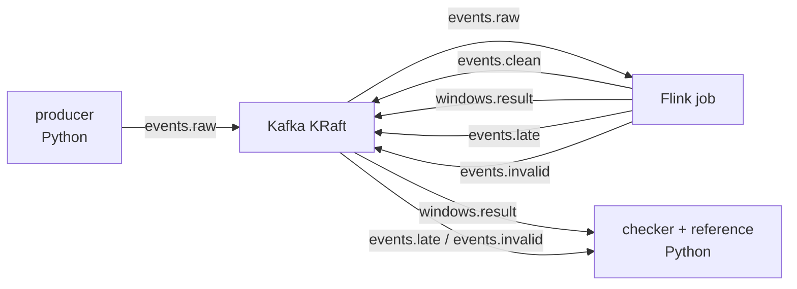

# 1. Схема стенда

## 1.1 Зачем это нужно

Хочу собрать отдельный стенд, то есть набор контейнеров, где можно спокойно
проверить, как ведёт себя потоковый конвейер, когда я специально его ломаю
Плюс чтобы всё было повторяемо и изолированно

Стенд должен уметь несколько вещей, подавать на вход поток событий, который при
одном seed всегда получается одинаковым, прогонять конвейер Kafka → Flink → Kafka
без отказов, это базовый прогон, или baseline, ломать систему в нужный момент,
это уже этап 3, и считать эталон отдельно от job, а потом самому сверять с ним то,
что получилось

## 1.2 Из чего состоит стенд

| Компонент | За что отвечает |
|---|---|
| Kafka (KRaft, 1 брокер) | Принимает входные события и хранит результат, тут лежат входной и выходной топики |
| Flink JobManager | Рулит job и координирует checkpoint'ы |
| Flink TaskManager | Выполняет операторы, фильтр → мап → окно |
| Flink job | Сама обработка, фильтр, преобразование, агрегация по окнам |
| producer (Python) | Генератор входного потока, при одном seed даёт один и тот же поток |
| reference (Python) | Эталонный расчёт, никак не связан с job |
| checker (Python) | Сравнивает факт с эталоном и считает метрики |
| faults (этап 3) | Штуки для внедрения отказов, `docker kill/stop`, `tc`, `iptables`, `kill -9` |

Тут важный момент, эталон не переиспользует код job, он написан отдельно на Python
по правилам из `02-event-processing-rules.md`, то есть это как бы вторая,
независимая реализация той же спецификации, иначе сравнение было бы нечестным

## 1.3 Топология и топики

| Топик | Куда идёт | Ключ | Партиции | Что внутри |
|---|---|---|---|---|
| `vkr.events.raw` | вход | `device_id` | 3 | Сырые события |
| `vkr.events.clean` | промежуточный | `device_id` | 3 | События после фильтра и преобразования |
| `vkr.windows.result` | выход | `device_id` | 3 | Итоговые агрегаты окон |
| `vkr.events.late` | side output | `device_id` | 1 | События, что опоздали сильнее, чем `allowedLateness` |
| `vkr.events.invalid` | side output | нет ключа | 1 | События, что не прошли фильтр или не распарсились |

Side output'ы `late` и `invalid` нужны, чтобы потерю было видно, любое входное
событие либо попадает в агрегат, либо явно уходит в side output, просто взять и
пропасть оно не может

## 1.4 Версии (зафиксированы жёстко)

Все образы и зависимости беру точной версией, а образы ещё и дайджестом,
`@sha256:`, при реализации, чтобы тег не уехал и сборка потом не сломалась

| Компонент | Версия | Почему так |
|---|---|---|
| Kafka broker | `apache/kafka:4.4.0` | KRaft без Zookeeper, одного узла хватает |
| Flink | `flink:2.2.0-scala_2.12-java17` | Тут есть точное совпадение с коннектором |
| flink-connector-kafka | `5.0.0-2.2` | Последний релиз со сборкой под Flink 2.2 |
| Java (job) | 17 | Как в базовом образе Flink |
| Сборка job | Maven, offline-версии зафиксированы | Чтобы сборка была воспроизводимой |
| Python (producer/reference/checker) | `python:3.12.15-slim-bookworm` | Одна версия со всем остальным стеком |

Про версии, коннектор `flink-connector-kafka` выходит с именем вида
`<версия>-<мажор.минор Flink>`, под Flink 2.3 сборки ещё нет, поэтому я взял
пару "Flink 2.2.0 + коннектор `5.0.0-2.2`", она самая воспроизводимая,
окончательно версии фиксирую уже при сборке стенда

## 1.5 Воспроизводимость

- Вход детерминирован, из seed генератора и параметров прогона всегда получается
  один и тот же поток событий
- `event_id` уникален, а если надо проверить обработку дублей, я специально
  повторяю событие генератором
- Все результаты и метрики пишутся в файл с `run_id`, то есть с номером прогона,
  чтобы потом можно было разбирать их по отдельности

## 1.6 Допущения и границы

- Инфраструктура (Kafka, Flink) в одном экземпляре, отказоустойчивость самой
  инфраструктуры я не исследую, мне интересно, как ведёт себя **сам job** при отказах
- Отказы я внедряю сам и повторяемо, "естественные" сбои машины тут исключены
- Время восстановления я измеряю, но в контракт корректности данных оно **не входит**,
  про метрики можно глянуть в README
